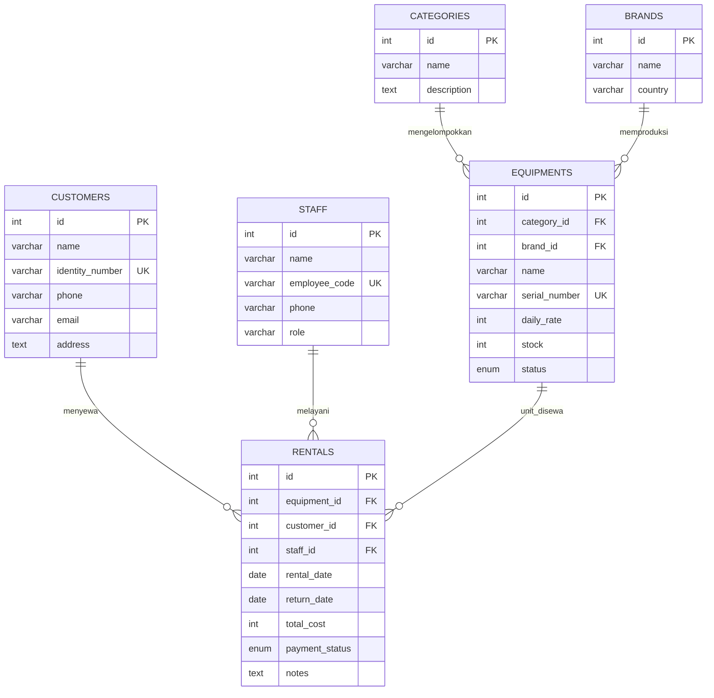

# LensGear Hub – Sistem Rental Multimedia

Aplikasi web berbasis PHP Native murni dengan arsitektur berorientasi objek (*Object-Oriented Programming* / OOP) untuk mengelola data inventaris peralatan multimedia dan transaksi peminjaman/rental kamera dengan operasi CRUD (*Create, Read, Update,* dan *Delete*). Pada TP7, aplikasi terhubung ke basis data MySQL `db_rental` menggunakan PDO dan Prepared Statement sehingga seluruh data yang ditambahkan, diubah, atau dihapus diproses langsung pada basis data secara aman, mendukung relasi multi-tabel (*Foreign Key*), serta melakukan sinkronisasi stok unit secara otomatis.

---

## 1. Desain dan Fungsi Program

Antarmuka **LensGear Hub** dirancang secara bersih dan modular (*Clean & Minimalist GUI*) yang terdiri dari formulir input modal, tombol aksi terarah, kartu ringkasan informasi, dan tabel data berpenomoran urut. Sistem ini mengelola 6 entitas yang saling berelasi:

- **Kategori (`categories`):** Mengelompokkan jenis peralatan (Kamera Mirrorless, Lensa, Lighting, Audio, Stabilizer, Drone).
- **Merek (`brands`):** Produsen dan negara asal pabrikan perangkat (Sony, Canon, Fujifilm, Godox, Rode, DJI).
- **Pelanggan (`customers`):** Data identitas penyewa mencakup nama lengkap, NIK KTP, kontak telepon/WhatsApp, email, dan alamat domisili.
- **Staf (`staff`):** Operator rental penanggung jawab transaksi mencakup kode pegawai (NIP), nama staf, kontak, dan peran jabatan.
- **Peralatan (`equipments`):** Inventaris fisik alat mencakup nama model, nomor seri unik (*serial number*), tarif sewa per hari, jumlah unit stok, status kesiapan (*available*, *maintenance*, *out of stock*), serta berelasi *Foreign Key* ke Kategori dan Brand.
- **Transaksi Rental (`rentals`):** Pencatatan sewa alat yang berelasi *Foreign Key* ke Alat, Pelanggan, dan Staf, mencakup tanggal pinjam, tanggal rencana kembali, total biaya sewa, status pembayaran/sewa (*unpaid*, *paid*, *returned*, *late*), dan catatan transaksi.

### Diagram Relasi Entitas (ERD)



### Fitur Utama

- **Create:** Menambahkan data baru pada keenam tabel (Kategori, Brand, Pelanggan, Staf, Alat, dan Transaksi Rental) menggunakan formulir modal.
- **Read:** Menampilkan data dari basis data pada tabel web dengan nomor urut dinamis per baris (`No`), menghubungkan relasi nama melalui query `JOIN`, dan menampilkan status dengan badge semantik.
- **Update:** Memperbarui data entitas yang dipilih melalui modal dialog edit tanpa mengubah ID unik pada basis data.
- **Delete:** Menghapus data setelah pengguna menyetujui konfirmasi dialog aksi.
- **Foreign Key Dropdown:** Form penambahan dan pengubahan alat serta transaksi rental mengambil data relasi secara dinamis langsung dari database.
- **Sinkronisasi Stok Otomatis:** Pembuatan transaksi rental otomatis memotong stok unit alat (-1). Tombol **Selesai** (*return rental*) otomatis mengubah status menjadi `returned` dan mengembalikan stok unit (+1).
- **Kalkulasi Biaya Otomatis:** Perhitungan total biaya rental dihitung otomatis berdasarkan selisih hari peminjaman dikalikan tarif sewa harian alat yang dipilih.
- **Keamanan Prepared Statement:** 100% eksekusi query menggunakan parameter binding PDO (`$stmt->prepare()` dan `$stmt->execute()`) untuk mencegah SQL Injection.
- **Post-Redirect-Get (PRG):** Mengalihkan halaman setelah aksi POST agar formulir tidak terkirim ganda saat pengguna melakukan refresh.

---

## 2. Teknologi yang Digunakan

- **Bahasa Pemrograman:** PHP (Versi 7.4 / 8.x - Native OOP murni tanpa framework)
- **Antarmuka (GUI):** HTML5, CSS3, JavaScript murni (Modular View & Responsive Layout)
- **Basis Data:** MySQL / MariaDB (Database: `db_rental`)
- **Akses Basis Data:** PDO (*PHP Data Objects*) dengan Prepared Statement
- **Web Server Lokal:** Apache melalui XAMPP / Laragon
- **Peramban Web:** Google Chrome / Microsoft Edge / Mozilla Firefox
- **Text Editor / IDE:** Visual Studio Code

---

## 3. Penjelasan Alur Program

1. **Inisialisasi & Koneksi:** Ketika aplikasi dibuka melalui `index.php`, sesi PHP dimulai dan koneksi ke basis data MySQL `db_rental` dibuat melalui class `Database` di `config/db.php`.
2. **Inisialisasi Model OOP:** Controller menginstansiasi 6 class model (`Category`, `Brand`, `Customer`, `Staff`, `Equipment`, `Rental`).
3. **Routing Halaman:** Parameter `$_GET['page']` menentukan modul aktif (default: `rentals`). Parameter yang diizinkan dipetakan ke berkas view yang sesuai di folder `view/`.
4. **Read Data:** Class model menjalankan query `SELECT` dengan *Prepared Statement* (menggunakan `JOIN` untuk tabel `equipments` dan `rentals`), lalu mengirimkan hasilnya ke file view untuk dirender ke tabel HTML.
5. **Create Data:** Pengguna mengisi formulir pada modal dan menekan tombol simpan. Permintaan HTTP POST diterima oleh `index.php`, memvalidasi input, dan memanggil method `add...()` pada class terkait. Jika berhasil, sistem melakukan redirect dengan pesan sukses.
6. **Update Data:** Pengguna menekan tombol Edit pada baris tabel. Parameter `edit_id` dimuat, modal edit terisi dengan data yang ada, lalu pengguna memperbarui data melalui method `update...()`.
7. **Delete Data:** Pengguna menekan tombol Hapus. Program meminta konfirmasi melalui JavaScript `confirm()`. Jika disetujui, aksi GET memanggil method `delete...()`. Jika data sedang terikat *Foreign Key*, sistem menangani exception dan menampilkan pesan peringatan yang ramah pengguna.
8. **Pengembalian Alat (Return):** Pada halaman Rental, pengguna menekan tombol Selesai. Method `Rental::returnRental()` memperbarui status menjadi `returned` dan secara otomatis memulihkan stok unit alat bersangkutan pada tabel `equipments`.
9. **Penutupan Antarmuka:** File `view/header.php` merender navbar, konten halaman disisipkan, dan `view/footer.php` menutup struktur dokumen HTML serta menyertakan logika kalkulasi sewa dan kontrol modal.

---

## 4. Dokumentasi Demonstrasi

Video demonstrasi pengujian program yang mencakup pengujian seluruh fitur CRUD pada 6 tabel relasional, relasi multi-tabel (*Foreign Key*), perhitungan biaya sewa otomatis, serta mekanisme sinkronisasi stok unit secara dinamis dapat diakses melalui tautan berikut:

- **Tautan Video YouTube:** [Tonton Video Demonstrasi LensGear Hub di YouTube](https://youtu.be/6wcwdxy_U9c?si=B-swz168CW4vXhbC)

---

## 5. Struktur Project

```text
TP7DPBO2526C2/
├── class/
│   ├── Brand.php
│   ├── Category.php
│   ├── Customer.php
│   ├── Equipment.php
│   ├── Rental.php
│   └── Staff.php
├── config/
│   └── db.php
├── database/
│   └── db_rental.sql
├── view/
│   ├── brands.php
│   ├── categories.php
│   ├── customers.php
│   ├── equipments.php
│   ├── footer.php
│   ├── header.php
│   ├── rentals.php
│   └── staff.php
├── index.php
├── style.css
└── README.md
```

Tautan video demonstrasi pada README di atas terhubung langsung ke rekaman resolusi tinggi (Full HD) di YouTube agar asisten dan dosen dapat mengamati setiap aksi dan nilai input dengan jelas.

---

## 6. Penjelasan Class dan File

### `config/db.php`
Mengelola koneksi ke basis data MySQL menggunakan PDO (*PHP Data Objects*), mengatur mode penanganan kesalahan ke `ERRMODE_EXCEPTION`, serta menyetel format *fetch* baku ke `FETCH_ASSOC`.

### `class/Category.php`
Mengelola operasi CRUD untuk tabel master `categories` (menambah kategori, mengambil seluruh kategori, mengambil data berdasarkan ID, memperbarui, dan menghapus kategori).

### `class/Brand.php`
Mengelola operasi CRUD untuk tabel master `brands` (menambah produsen, membaca daftar merek, mengubah, dan menghapus data produsen).

### `class/Customer.php`
Mengelola data penyewa pada tabel `customers` mencakup nama, NIK unik, kontak telepon, email, dan alamat tempat tinggal.

### `class/Staff.php`
Mengelola data petugas operator pada tabel `staff` mencakup kode pegawai (NIP unik), nama staf, kontak, dan jabatan operasional.

### `class/Equipment.php`
Mengelola inventaris perangkat pada tabel `equipments`. Method `getAllEquipments()` melakukan query `JOIN` dengan tabel `categories` dan `brands` untuk mengambil nama kategori dan merek. Dilengkapi method `updateStock()` untuk menyesuaikan stok unit dan memperbarui status kesiapan alat secara otomatis.

### `class/Rental.php`
Mengontrol transaksi peminjaman pada tabel `rentals`. Method `getAllRentals()` menggabungkan data dari tabel `equipments`, `customers`, dan `staff`. Method `addRental()` memeriksa ketersediaan unit dan memotong stok secara otomatis, method `returnRental()` mengubah status transaksi menjadi `returned` sekaligus mengembalikan stok alat, dan method `deleteRental()` mengembalikan stok jika transaksi dibatalkan sebelum pengembalian.

### `index.php`
Merupakan titik awal (*entry point*), *router*, dan *controller* pusat aplikasi. Bertugas memproses permintaan HTTP POST (Create/Update), HTTP GET (Delete/Return), mengelola pesan notifikasi sesi (*flash messages*), serta menyertakan tampilan modular berdasarkan query string `?page=...`.

### `view/header.php` & `view/footer.php`
Bagian tata letak antarmuka global. `header.php` menyertakan navigasi navbar bersih dan notifikasi alert, sedangkan `footer.php` memuat penutup HTML, logika JavaScript untuk membuka/menutup modal, dialog konfirmasi hapus, dan fungsi kalkulasi biaya sewa harian otomatis.

### `view/*.php` (Berkas View Per Entitas)
Menampilkan tabel data berpenomoran urut (`No`), kartu statistik ringkas, formulir modal tambah data, dan modal ubah data untuk masing-masing entitas secara modular.

### `style.css`
Menyimpan seluruh aturan gaya antarmuka aplikasi dengan filosofi desain bersih, minimalis, proporsional, dan responsif tanpa menggunakan ikon atau ornamen visual yang berlebihan.

### `database/db_rental.sql`
Berisi perintah DDL untuk membuat basis data `db_rental`, 6 tabel relasional dengan batasan *Foreign Key Constraints*, serta kueri DML berupa data awal (*dummy seeding*) agar aplikasi langsung memiliki data ketika pertama kali dijalankan.